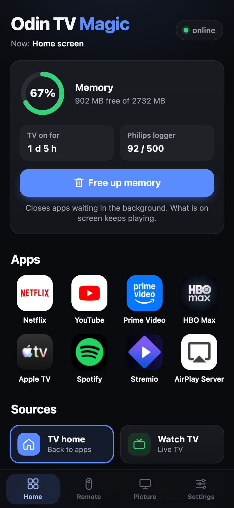
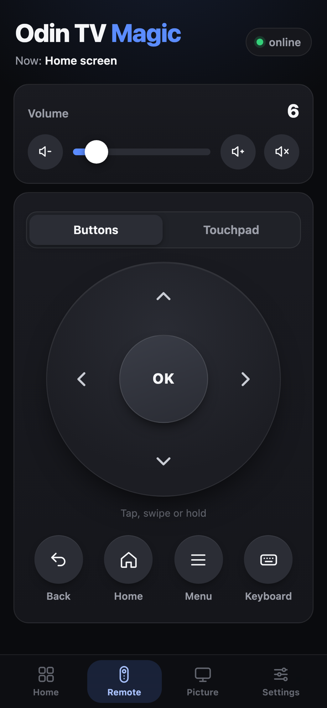
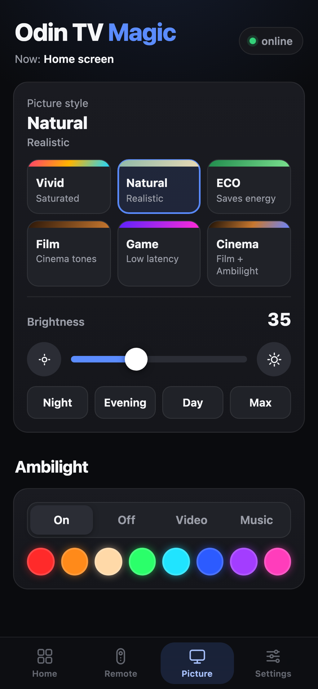
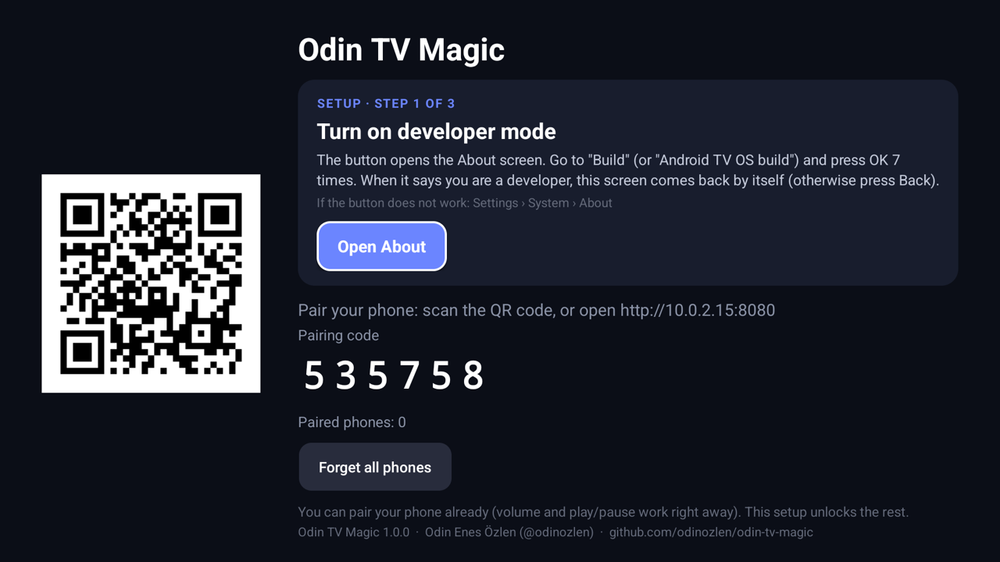

# Odin TV Magic

### Your smart TV is slow, full of junk, and the remote is lost again. Fix all three from your phone.

**Odin TV Magic turns any phone browser into a fast remote for Android TV and Google TV, frees the TV's
memory in one tap and switches off the pre-installed bloat. No app on the phone, no root, no cloud;
the only request outside your home is a daily update check you can turn off.**

[Türkçe](README.tr.md)

<p align="center">
  
  
  
</p>

- ⚡ **Make an old TV feel new:** free memory in one tap, turn off pre-installed apps you never open (undo any time), swap the ad-filled home screen for a clean one.
- 📱 **A better remote than the one in the couch:** D-pad, touchpad, keyboard, volume, app and input shortcuts. Scan a QR code on the TV and it is on your phone's home screen.
- 🧙 **Set up with the remote only:** the app on the TV walks you through developer mode step by step and opens every settings screen for you.
- 🌈 **Philips owners get extra:** Ambilight, picture styles, brightness, and an automatic fix for Netflix freezing at 86%.
- 🔒 **Yours, local and open:** signed requests, pairing only from the TV screen, MIT licensed.

> 🤖 **Using an AI assistant?** Give it this repository and say *"set up Odin TV Magic on my TV"*.
> [AGENTS.md](AGENTS.md) tells Claude, ChatGPT, Codex and others exactly what to do and what never to do.

<p align="center"></p>

## Features

| | Any Android TV / Google TV | Philips Android TV (extra) |
|---|---|---|
| Remote: D-pad (tap, swipe, hold), back, home, menu, media keys; keys go through a warm injector, no lag | ✅ | via JointSpace |
| Volume and mute | ✅ | real speaker volume |
| Playing-now bar, touchpad mode, active input highlighted, first-run setup | ✅ | |
| Keyboard: type into TV search fields | ✅ (Latin letters) | any language |
| Open apps (your choice of favourites, with icons) | ✅ | |
| Inputs: the TV tuner ("Watch TV") and connected HDMI devices, with their names (HDMI-CEC) | ✅ (TVs with inputs) | |
| **Clean up**: closes background apps, never the one on screen, music that is playing or receivers like AirPlay | ✅ | + restarts the leaking logger |
| Screenshot of the TV screen | ✅ | |
| **Change your TV's look**: switch to Projectivy or FLauncher (installs from the Play Store) and back | ✅ | |
| **Speed up the TV**: suggests pre-installed apps to turn off (never uninstalls, one tap to undo) | ✅ (safe common list) | + tested Philips list |
| **AirPlay** for TVs without it: show your iPhone, iPad or Mac screen, photos and videos on the TV. One-tap install of an open-source receiver (checksum-verified); it then starts with the TV | ✅ | |
| Party mode: a 45 s "your TV got hacked" show (off by default) | ✅ | + Ambilight effects |
| Ambilight: on/off, follow video/music, 8 colours | | ✅ |
| Picture style (Vivid, Natural, Movie, Game…) incl. HDR / Dolby Vision lists | | ✅ |
| Brightness with presets | | ✅ |
| **Netflix stuck at 86% fix**: automatic, every 30 min ([why](docs/philips-netflix-freeze.md)) | | ✅ |

The phone UI is English or Turkish (follows the phone, switchable).

## How it works

```
 phone browser ──(signed HTTP, LAN only)──▶ Odin TV Magic app on the TV ──▶ TV's own ADB (127.0.0.1)
                                                                   └──────▶ Philips JointSpace (127.0.0.1:1926)
```

The app talks to the TV's own debugging bridge (ADB) over loopback, the same way a computer would,
so it can press keys, open apps and read state without root. On Philips TVs it also uses the TV's
local JointSpace API. Nothing leaves your network except the update check (below).

## Install

**What you need:** an Android TV / Google TV (Android 8+) and a phone on the same Wi-Fi. Your phone only
needs a browser.

**You use it from your phone.** The TV app only shows the setup and a QR code; the remote, apps and
settings open on the phone. A computer (or an AI assistant on it) is only needed to install, if at all.

1. **Install the APK** from [Releases](https://github.com/odinozlen/odin-tv-magic/releases/latest) (direct link:
   `https://github.com/odinozlen/odin-tv-magic/releases/latest/download/odin-tv-magic.apk`), or [build it](#build).
   Either way works:
   - **On the TV, no computer:** install *Downloader* (by AFTVnews) from the Play Store, type
     **`odinozlen.com/tv`** (a short link to the latest APK) and allow Downloader to install apps when the TV asks.
   - **From a computer** (needs step 2's switches first):
     ```bash
     adb connect <tv-ip>:5555
     adb install odin-tv-magic.apk
     ```
     or `scripts/tv.sh install <tv-ip>`. Google TV without port 5555: pair your computer first with
     `adb pair <tv-ip>:<pairing-port>` (Developer options › Wireless debugging › Pair device with pairing code).
2. **Open "Odin TV Magic" on the TV and follow the setup on the screen.** It checks what is missing and
   opens the right settings screen for each step, so you only use the remote (about a minute):
   1. *Developer mode:* the button opens *About*; press **Build** (or *Android TV OS build*; on Fire TV the
      device name) 7 times. The app comes back by itself.
   2. *USB debugging:* the button opens *Developer options*; turn on **USB debugging** (and **Network
      debugging** if your TV has that switch).
   3. *Allow:* the TV asks *"Allow debugging?"*. Tick *Always allow*, press *Allow*.

   Google TV / Android 12+ without a network-debugging switch: turn on **Wireless debugging** instead and
   enter its pairing code in the panel (*Settings › TV connection*). Tick **Always allow on this network**
   so the app can switch it back on after a reboot.
3. **Scan the QR code on the TV with your phone camera.** The panel opens on the phone and the phone is
   paired. You can do this before step 2: the panel then starts in *basic mode* (below) and unlocks the
   rest when the setup is done. Then add it to the phone's home screen so it opens like an app, without
   the QR code: iPhone: Safari *Share › Add to Home Screen*; Android: Chrome *⋮ › Add to Home screen*.
   Opened on a computer, the panel first says it is made for the phone.
4. **Philips only:** tap *Show PIN on TV* in the panel and enter the PIN to unlock Ambilight & co.

**Basic mode (before the ADB setup).** The panel already works with what Android allows any app:
volume and play/pause on every TV. On Philips, after the PIN, also the remote, keyboard, apps, sleep,
brightness and Ambilight (through the TV's own JointSpace API). Cleanup, inputs, screenshots, picture
styles and the TV tools need the setup; the panel dims them until then.

After a reboot the app starts by itself. On Google TV it switches wireless debugging back on
(this works on a Wi-Fi network you marked as trusted).

## Updates

Once a day the TV asks GitHub for the latest release
(`https://api.github.com/repos/odinozlen/odin-tv-magic/releases/latest`, with the User-Agent
`OdinTVMagic/<version>` and nothing else about you or the TV). When there is a newer version the panel shows
*"1.0.x is ready – Update"* and the TV screen shows a line. Nothing is installed until you tap **Update**.
Then the TV downloads the APK from the GitHub release, checks it against the release's
`odin-tv-magic.apk.sha256` file, checks that it is signed with the same key as the installed app, and installs
it through its own ADB connection (like `adb install -r`). Paired phones and settings stay; the panel reloads
by itself after about a minute.

- **Turn it off:** panel *Settings › Updates › Automatic update check*. Off means no request to GitHub at all.
- **Without the ADB setup** (basic mode) the panel cannot install: on the TV, open *Downloader*, type
  `odinozlen.com/tv` and install over the old version (settings and paired phones stay). From a computer:
  `adb install -r odin-tv-magic.apk`.

## Security

Read this before installing. [SECURITY.md](SECURITY.md) has the details.

- **Pairing:** only a phone that saw the TV screen can pair. The 6-digit code is single-use, valid only
  while the TV screen is open, and burns after 5 wrong tries.
- **Signed requests:** each paired phone gets a random 256-bit key. Requests are signed with HMAC-SHA256 plus a
  timestamp and a nonce, so the key never travels over the network and recorded requests cannot be replayed.
- **Browser protections:** DNS-rebinding protection (IP-only Host), no CORS, strict Content-Security-Policy.
- **Keep it at home.** Network/wireless debugging gives every device on your LAN a way to *ask* for control of
  the TV. **Never accept an "Allow debugging?" prompt you did not trigger.** Do not use this on public or
  shared networks, and never forward port 5555 or 8080 on your router.
- Remove phones any time: panel *Settings › Paired phones*, or *Forget all phones* on the TV screen.
- **Updates** only install when you tap *Update*, and only an APK that matches the release's SHA-256 file and
  is signed with the same key as the installed app. The daily check can be turned off ([Updates](#updates)).

## Troubleshooting

- **"Allow debugging?" never appears:** press *Show the window again* on the TV's setup screen (or *Check again* in the panel). If it is still missing, the TV's ADB is stuck on an old prompt: turn *USB debugging* off and on again in Developer options.
- **The setup button does not open the settings screen** (some brands hide it): the step shows the menu path to use instead.

- **`adb connect` says "No route to host" on macOS although the TV answers ping:** macOS blocks local-network
  access for that program. Allow your terminal in *System Settings › Privacy & Security › Local Network*, or
  run `adb kill-server` and start adb again from a terminal that is allowed.
- **Panel says "Approve Allow debugging?" but nothing is on the TV, even after the steps above:** the TV
  thinks a prompt is still open. Run `adb tcpip 5555` once from a computer (restarts the TV's ADB), then
  press *Check again* in the panel.
- **Philips: no PIN appears, or Ambilight does not react:** the panel now says why (the TV refused
  pairing, JointSpace does not answer, or the TV ignored the command). Open *Picture › Philips diagnostics*,
  copy the text and add it to your [issue](https://github.com/odinozlen/odin-tv-magic/issues): it lists
  only the TV model, Android version and what its JointSpace API reports. Newer Philips Google TV
  firmware is not tested yet.
- **AirPlay: the TV does not appear on the iPhone:** open *Settings › AirPlay* in the panel. *On* means
  the receiver runs; on the iPhone open Control Center › *Screen Mirroring* and pick the name shown there
  (by default *Android AirPlay*), with the phone on the same Wi-Fi as the TV. *Installed but off*: tap
  *Turn on*. On the TV the app is called *AirPlay Server* (under Apps); it does not need to stay open.
  Before 1.0.3 the panel installed it but on Android 12+ / Google TV did not start it: tap *Turn on* once.
  The iPhone connects but the TV shows nothing: update to 1.0.4 (it lets the receiver open its screen).
  For videos use the AirPlay button inside the app (YouTube, Photos): screen mirroring can drift out of
  sync on some TVs, in-app AirPlay stays in sync.
- **"Allow debugging?" does not come back:** if it was closed without an answer, Android waits for it and
  skips new ones. Turn *USB debugging* off and on in Developer options; the app then asks again.
- **Apps say "no internet" but the network works:** the TV clock is wrong and TLS fails. Turn on automatic
  date & time (`adb shell settings put global auto_time 1`).
- **Google TV loses the connection after a reboot:** in *Wireless debugging* make sure *Always allow on this
  network* was ticked; the app can only switch it back on for trusted Wi-Fi networks.

## Debloat (optional)

Removing pre-installed apps frees memory and stops tracking. This repo includes a list tested on a
Philips 50PUS8507 (Android 11): [debloat/philips-android11.txt](debloat/philips-android11.txt), plus a
[keep list](debloat/philips-keep.txt) of packages that break the TV when disabled.

```bash
scripts/tv.sh baseline <tv-ip>                                  # save the current state first
scripts/tv.sh disable  <tv-ip> debloat/philips-android11.txt    # disable-user only, recorded
scripts/tv.sh restore  <tv-ip>                                  # undo everything
```

Only `pm disable-user` is used, never uninstall. Edit the list first and keep what you use.

**Not a Philips?** Use these great projects for debloating and home screens; the panel works alongside them:
- [cleanyourtv](https://github.com/Gathin23/cleanyourtv): tested lists for 170+ TV models and an ad-free home screen.
- [Tellyscope](https://github.com/man15h/tellyscope): debloat and manage your TV from an Android phone.
- [Projectivy Launcher](https://play.google.com/store/apps/details?id=com.spocky.projengmenu), [FLauncher](https://github.com/svrooij/flauncher): alternative home screens.

## Build

No Android Studio or Gradle needed. Linux or macOS:

```bash
scripts/setup-toolchain.sh   # pinned JDK 17 + Android SDK in .toolchain/ (checksums verified)
scripts/build.sh             # -> build/odin-tv-magic.apk
```

`setup-toolchain.sh` asks you to accept Google's Android SDK license. Releases upload two files:
`odin-tv-magic.apk` and `odin-tv-magic.apk.sha256` (`shasum -a 256 odin-tv-magic.apk`); the in-app update
refuses a release without the checksum file. Builds are signed with a personal key
created in `~/.odin-tv-magic/` (keep it: Android only accepts updates signed with the same key).

## Compatibility

Every release is run through an end-to-end test (install, ADB approval, phone pairing, security
checks, apps, remote, volume, screenshot, keyboard, cleanup, launchers, speed-up and undo, port
fallback, start after reboot) on these systems:

| System | Result |
|---|---|
| Philips 50PUS8507 (Android TV 11, real TV) | All features, used daily |
| Android TV 16 (emulator) | 39/39 |
| Google TV 14 (emulator) | 39/39 |
| Android TV 13 (emulator) | 39/39 |
| Android TV 12 (emulator) | 39/39, also when the TV forgets "Always allow" |
| Android 11, 9 and 8 (system images; no TV images exist for these on Apple silicon) | All panel functions; volume keys not testable without audio hardware |

Notes:

- **Android 8 and newer** (minSdk 26). Pure Java, no native code: runs on 32- and 64-bit ARM and x86.
- **Connecting**: on most TVs turning on *USB debugging* is enough (TVs have no USB data port, so
  ADB listens on the network). Some have a separate *Network debugging* switch. Android 12+ can
  also use *Wireless debugging* with a pairing code from the panel.
- **HDMI sticks and soundbars**: when Android's own volume is fixed (Chromecast-style sticks, sound
  over HDMI ARC), the panel shows − / + / mute, which send the remote's volume keys to the TV or
  soundbar.
- **Port**: the panel uses 8080; if another app (Kodi, a media server…) holds it, it moves to the
  next free port and shows the new address on the TV.
- **Philips extras** (Ambilight, picture style, logger watchdog) appear only on Philips sets. Ambilight
  and picture need a one-time pairing: *Show PIN on TV* in the Ambilight card. Ambilight is hidden if the
  TV reports none, and the panel says so if the TV's JointSpace interface does not answer.

## Credits

- Philips JointSpace protocol and pairing: [pylips](https://github.com/eslavnov/pylips), [ha-philipsjs](https://github.com/danielperna84/ha-philipsjs)
- SPAKE2 for wireless-debugging pairing: written from [BoringSSL](https://boringssl.googlesource.com/boringssl/) (Apache-2.0), protocol from AOSP `adb`
- QR codes: [Nayuki QR Code generator](https://www.nayuki.io/page/qr-code-generator-library) (MIT)
- Similar idea, different scope: [TV Remote](https://github.com/Legvan/tv-remote)

See [NOTICE](NOTICE) for licenses. Philips and Ambilight are trademarks of Koninklijke Philips N.V.;
this project is not affiliated with Philips or TP Vision.

## Author

Made by **Odin Enes Özlen** ([@odinozlen](https://github.com/odinozlen)) · [hi@odinozlen.com](mailto:hi@odinozlen.com) · [github.com/odinozlen](https://github.com/odinozlen)

## License

[MIT](LICENSE)
