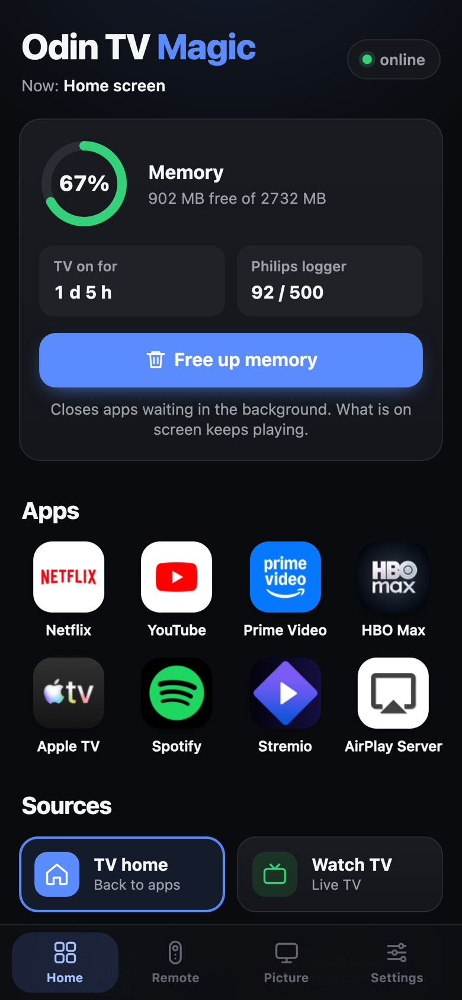
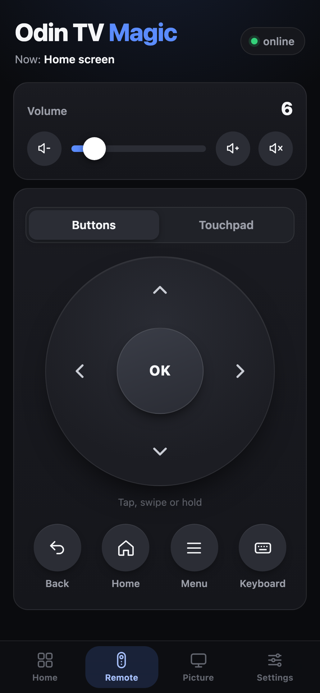
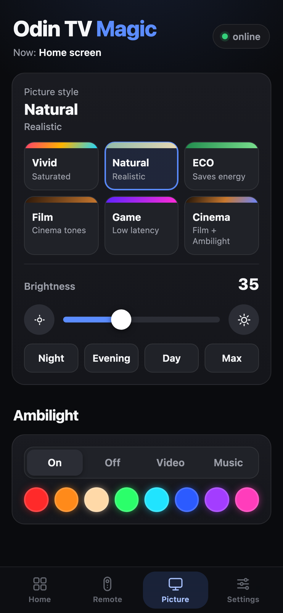
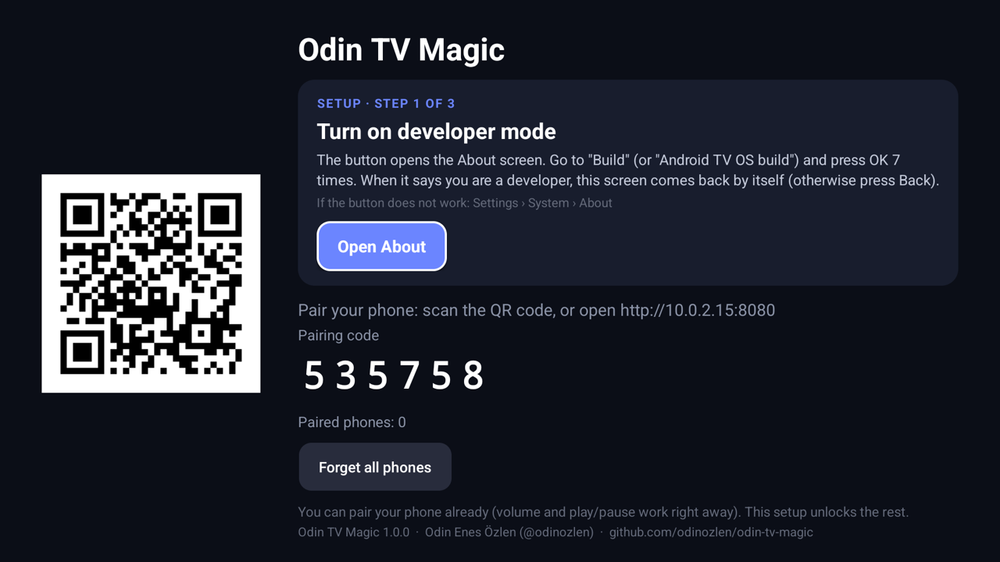

# Odin TV Magic

### Akıllı TV'n yavaş, gereksiz uygulamalarla dolu ve kumanda yine kayıp mı? Üçünü de telefonundan çöz.

**Odin TV Magic, herhangi bir telefon tarayıcısını Android TV ve Google TV için hızlı bir kumandaya çevirir,
TV'nin belleğini tek dokunuşla boşaltır ve ön yüklü gereksiz uygulamaları kapatır. Telefona uygulama yok,
root yok, bulut yok; ev ağının dışına giden tek istek, kapatabileceğin günlük güncelleme denetimi.**

[English](README.md)

<p align="center">
  
  
  
</p>

- ⚡ **Eski TV yeni gibi:** tek dokunuşla bellek boşalt, hiç açmadığın ön yüklü uygulamaları kapat (her zaman geri alınır), reklamlı ana ekranı sade bir ekranla değiştir.
- 📱 **Koltuğun arasındakinden iyi bir kumanda:** yön tuşları, touchpad, klavye, ses, uygulama ve kaynak kısayolları. TV'deki karekodu okut, telefonunun ana ekranına gelsin.
- 🧙 **Yalnızca kumandayla kurulum:** TV'deki uygulama geliştirici modunu adım adım anlatır ve her ayar ekranını senin için açar.
- 🌈 **Philips sahiplerine ekstra:** Ambilight, görüntü tarzları, parlaklık ve Netflix'in %86'da takılmasına otomatik çözüm.
- 🔒 **Senin, yerel ve açık:** imzalı istekler, yalnızca TV ekranından eşleşme, MIT lisansı.

> 🤖 **Yapay zekâ kullanıyor musun?** Bu repoyu Claude, ChatGPT ya da Codex'e ver ve *"Odin TV Magic'i
> TV'me kur"* de. [AGENTS.md](AGENTS.md) asistana ne yapacağını ve neyi asla yapmayacağını anlatır.

<p align="center"></p>

## Özellikler

| | Her Android TV / Google TV | Philips Android TV (ek) |
|---|---|---|
| Kumanda: yön tuşları (dokun, kaydır, basılı tut), geri, ana ekran, menü, medya tuşları; gecikmesiz | ✅ | JointSpace ile |
| Ses ve sessiz | ✅ | gerçek hoparlör sesi |
| Şu an oynayan çubuğu, touchpad modu, etkin kaynak vurgusu, ilk kurulum akışı | ✅ | |
| Klavye: TV'deki arama kutularına yaz | ✅ (Latin harfler) | her dil |
| Uygulama aç (seçtiğin favoriler, ikonlarıyla) | ✅ | |
| Kaynaklar: TV yayını ("TV izleme") ve bağlı HDMI cihazları, adlarıyla (HDMI-CEC) | ✅ (girişi olan TV'ler) | |
| **Temizle**: arka plandaki uygulamaları kapatır; ekrandakine, çalan müziğe ve AirPlay gibi alıcılara dokunmaz | ✅ | + sızdıran logger'ı yeniden başlatır |
| TV ekran görüntüsü | ✅ | |
| **TV görünümünü değiştir**: Projectivy ya da FLauncher'a geç (Play Store'dan kurar) ve geri al | ✅ | |
| **TV'yi hızlandır**: kapatılabilecek ön yüklü uygulamaları önerir (asla silmez, tek dokunuşla geri alınır) | ✅ (güvenli ortak liste) | + test edilmiş Philips listesi |
| **AirPlay** olmayan TV'lere: iPhone, iPad ya da Mac ekranını, fotoğraf ve videolarını TV'de göster. Açık kaynak alıcıyı tek dokunuşla kur (sağlaması doğrulanır); sonra TV ile birlikte açılır | ✅ | |
| Sürpriz modu: 45 sn'lik "TV hacklendi" gösterisi (varsayılan kapalı) | ✅ | + Ambilight efektleri |
| Ambilight: aç/kapat, videoyu/müziği takip, 8 renk | | ✅ |
| Görüntü tarzı (Canlı, Doğal, Film, Oyun…), HDR / Dolby Vision listeleri dahil | | ✅ |
| Hazır ayarlı parlaklık | | ✅ |
| **Netflix %86'da takılıyor çözümü**: otomatik, 30 dk'da bir ([neden](docs/philips-netflix-freeze.md)) | | ✅ |

Panel Türkçe ya da İngilizce (telefonun diline göre, değiştirilebilir).

## Kurulum

**Gerekenler:** Android TV / Google TV (Android 8+) ve aynı Wi-Fi'da bir telefon. Telefonda yalnızca
tarayıcı lazım.

**Telefonundan kullanırsın.** TV'deki uygulama yalnızca kurulumu ve bir karekodu gösterir; kumanda,
uygulamalar ve ayarlar telefonda açılır. Bilgisayar (ya da üzerindeki yapay zekâ asistanı) en fazla kurulum için gerekir.

1. **APK'yı kur:** [Releases](https://github.com/odinozlen/odin-tv-magic/releases/latest)'tan (doğrudan bağlantı:
   `https://github.com/odinozlen/odin-tv-magic/releases/latest/download/odin-tv-magic.apk`) ya da [derle](#derleme).
   İki yol da olur:
   - **TV'den, bilgisayarsız:** Play Store'dan *Downloader*'ı (AFTVnews) kur, **`odinozlen.com/tv`** yaz
     (son sürümün APK'sına kısa bağlantı) ve TV sorduğunda Downloader'ın uygulama yüklemesine izin ver.
   - **Bilgisayardan** (önce 2. adımdaki anahtarlar açık olmalı):
     ```bash
     adb connect <tv-ip>:5555
     adb install odin-tv-magic.apk
     ```
     ya da `scripts/tv.sh install <tv-ip>`. 5555 portu olmayan Google TV: önce bilgisayarını
     `adb pair <tv-ip>:<eşleştirme-portu>` ile eşle (Geliştirici seçenekleri › Kablosuz hata ayıklama › Eşleştirme koduyla cihaz eşle).
2. **TV'de "Odin TV Magic"i aç ve ekrandaki kurulumu izle.** Neyin eksik olduğunu kendisi bulur ve her adım
   için doğru ayar ekranını açar; yalnızca kumandayı kullanırsın (yaklaşık bir dakika):
   1. *Geliştirici modu:* düğme *Hakkında*'yı açar; **Derleme**'ye (ya da *Android TV OS derlemesi*; Fire TV'de
      cihaz adına) 7 kez bas. Uygulama kendiliğinden geri gelir.
   2. *USB hata ayıklama:* düğme *Geliştirici seçenekleri*'ni açar; **USB hata ayıklama**'yı (TV'nde varsa
      **Ağ üzerinden hata ayıklama**'yı da) aç.
   3. *İzin:* TV *"Hata ayıklamaya izin verilsin mi?"* diye sorar. *Her zaman izin ver*'i işaretle, *İzin ver*'e bas.

   Ağ üzerinden hata ayıklama anahtarı olmayan Google TV / Android 12+: bunun yerine **Kablosuz hata ayıklama**'yı
   aç ve eşleştirme kodunu panelde gir (*Ayarlar › TV bağlantısı*). **Bu ağda her zaman izin ver**'i işaretle
   ki uygulama yeniden başlatmadan sonra onu tekrar açabilsin.
3. **TV'deki karekodu telefonunun kamerasıyla okut.** Panel telefonda açılır, telefon eşleşir. Bunu 2. adımdan
   önce de yapabilirsin: panel o zaman *temel mod*da açılır (aşağıda), kurulum bitince gerisi açılır. Sonra
   telefonun ana ekranına ekle ki karekodsuz, uygulama gibi açılsın: iPhone'da Safari *Paylaş › Ana Ekrana Ekle*;
   Android'de Chrome *⋮ › Ana ekrana ekle*. Bilgisayarda açılırsa panel önce telefon için yapıldığını söyler.
4. **Yalnızca Philips:** panelde *TV'de PIN göster*'e bas ve PIN'i gir (Ambilight ve diğerleri için).

**Temel mod (ADB kurulumundan önce).** Panel, Android'in her uygulamaya izin verdiği şeylerle şimdiden çalışır:
her TV'de ses ve oynat/duraklat. Philips'te PIN'den sonra ayrıca kumanda, klavye, uygulamalar, uyku, parlaklık
ve Ambilight (TV'nin kendi JointSpace API'siyle). Temizlik, kaynaklar, ekran görüntüsü, görüntü tarzı ve TV
araçları kurulum ister; panel o zamana kadar bunları soluk gösterir.

Yeniden başlatmadan sonra uygulama kendiliğinden açılır. Google TV'de kablosuz hata ayıklamayı da tekrar açar
(güvenilir olarak işaretlediğin bir Wi-Fi ağında çalışır).

## Güncellemeler

TV günde bir kez GitHub'a en yeni sürümü sorar
(`https://api.github.com/repos/odinozlen/odin-tv-magic/releases/latest`; User-Agent `OdinTVMagic/<sürüm>`,
sen ya da TV hakkında başka hiçbir bilgi gitmez). Yeni sürüm varsa panelde *"1.0.x hazır – Güncelle"*, TV
ekranında da bir satır çıkar. Sen **Güncelle**'ye dokunmadan hiçbir şey kurulmaz. Dokununca TV APK'yı GitHub
sürümünden indirir, sürümdeki `odin-tv-magic.apk.sha256` dosyasıyla karşılaştırır, yüklü uygulamayla aynı
anahtarla imzalı olduğunu kontrol eder ve kendi ADB bağlantısıyla kurar (`adb install -r` gibi). Eşleşmiş
telefonlar ve ayarlar kalır; panel yaklaşık bir dakika sonra kendiliğinden yenilenir.

- **Kapatmak için:** panelde *Ayarlar › Güncellemeler › Otomatik güncelleme kontrolü*. Kapalıyken GitHub'a hiç istek gitmez.
- **ADB kurulumu yoksa** (temel mod) panel kuramaz: TV'de *Downloader*'ı aç, `odinozlen.com/tv` yaz ve eski
  sürümün üzerine kur (ayarlar ve eşleşmiş telefonlar kalır). Bilgisayardan: `adb install -r odin-tv-magic.apk`.

## Güvenlik

Kurmadan önce oku. Ayrıntılar: [SECURITY.md](SECURITY.md).

- Yalnızca TV ekranını gören bir telefon eşleşebilir. Kod tek kullanımlık, yalnızca o ekran açıkken
  geçerli, 5 yanlış denemede yanar.
- Her telefon rastgele 256 bitlik bir anahtar alır. İstekler HMAC-SHA256 + zaman damgası + tek kullanımlık
  değerle imzalanır; anahtar ağda hiç dolaşmaz, kaydedilen istekler tekrar oynatılamaz.
- **Evde kullan.** Ağ/kablosuz hata ayıklama, ağdaki her cihaza TV'yi yönetmek için *izin isteme*
  imkânı verir. **Senin başlatmadığın bir "Hata ayıklamaya izin ver" penceresini asla onaylama.**
  Ortak ağlarda kullanma, modemde 5555 / 8080 portlarını asla dışarı açma.
- **Güncellemeler** yalnızca sen *Güncelle*'ye dokununca, yalnızca sürümün SHA-256 dosyasıyla eşleşen ve yüklü
  uygulamayla aynı anahtarla imzalı bir APK ise kurulur. Günlük denetim kapatılabilir ([Güncellemeler](#güncellemeler)).

## Sorun giderme

- **"Hata ayıklamaya izin verilsin mi?" penceresi hiç çıkmıyor:** TV'deki kurulum ekranında *Pencereyi tekrar göster*'e (ya da panelde *Tekrar kontrol et*'e) bas. Yine çıkmazsa TV'nin ADB'si eski bir soruda takılmıştır: Geliştirici seçenekleri'nde *USB hata ayıklama*'yı kapatıp tekrar aç.
- **Kurulum düğmesi ayar ekranını açmıyor** (bazı markalar gizler): adım, bunun yerine kullanılacak menü yolunu gösterir.

- **macOS'ta `adb connect` "No route to host" diyor ama TV ping'e cevap veriyor:** macOS o programın yerel ağa
  erişimini engelliyor. *Sistem Ayarları › Gizlilik ve Güvenlik › Yerel Ağ*'da terminaline izin ver ya da
  `adb kill-server` yapıp adb'yi izinli bir terminalden yeniden başlat.
- **Panel "Hata ayıklamaya izin ver'i onayla" diyor ama TV'de pencere yok:** TV pencerenin hâlâ açık olduğunu
  sanıyor. Bilgisayardan bir kez `adb tcpip 5555` çalıştır (TV'nin ADB'sini yeniden başlatır), sonra panelde
  *Tekrar kontrol et*'e bas.
- **Philips: PIN çıkmıyor ya da Ambilight tepki vermiyor:** panel artık nedenini söylüyor (TV eşleştirmeyi
  reddetti, JointSpace yanıt vermiyor ya da TV komutu yok saydı). *Görüntü › Philips tanı bilgisi*'ni aç,
  metni kopyala ve [hata bildirimine](https://github.com/odinozlen/odin-tv-magic/issues) ekle: yalnızca TV
  modelini, Android sürümünü ve JointSpace API'sinin bildirdiklerini içerir. Yeni Philips Google TV
  yazılımları henüz test edilmedi.
- **AirPlay: TV iPhone'da görünmüyor:** panelde *Ayarlar › AirPlay*'e bak. *Açık* ise alıcı çalışıyordur;
  iPhone'da Denetim Merkezi › *Ekran Yansıtma*'yı aç ve orada yazan adı seç (varsayılan *Android AirPlay*);
  telefon TV ile aynı Wi-Fi'da olmalı. *Yüklü ama kapalı* ise *Aç*'a dokun. TV'de uygulamanın adı *AirPlay
  Server*'dır (Uygulamalar'da); açık kalması gerekmez. 1.0.3'ten önce panel onu kuruyor ama Android 12+ /
  Google TV'de başlatmıyordu: bir kez *Aç*'a dokun.
- **Uygulamalar "internet yok" diyor ama ağ çalışıyor:** TV'nin saati yanlış, TLS başarısız oluyor. Otomatik
  tarih ve saati aç (`adb shell settings put global auto_time 1`).
- **Google TV yeniden başlayınca bağlantı kopuyor:** *Kablosuz hata ayıklama*'da *Bu ağda her zaman izin ver*'in
  işaretli olduğundan emin ol; uygulama onu yalnızca güvenilir Wi-Fi ağlarında tekrar açabilir.

## Debloat (isteğe bağlı)

Philips 50PUS8507'de (Android 11) test edilmiş liste: [debloat/philips-android11.txt](debloat/philips-android11.txt)
ve kapatılınca TV'yi bozan paketler: [debloat/philips-keep.txt](debloat/philips-keep.txt).

```bash
scripts/tv.sh baseline <tv-ip>                                  # önce mevcut durumu kaydet
scripts/tv.sh disable  <tv-ip> debloat/philips-android11.txt    # yalnızca disable-user, kayıtlı
scripts/tv.sh restore  <tv-ip>                                  # hepsini geri al
```

Asla kaldırma (uninstall) yapılmaz. Listeyi önce düzenle, kullandıklarını çıkar.

**Philips değil mi?** Debloat ve ana ekran için bu projeleri kullan; panel onlarla birlikte çalışır:
[cleanyourtv](https://github.com/Gathin23/cleanyourtv) (170+ model için test edilmiş listeler),
[Tellyscope](https://github.com/man15h/tellyscope) (Android telefondan yönetim),
[Projectivy Launcher](https://play.google.com/store/apps/details?id=com.spocky.projengmenu) ve
[FLauncher](https://github.com/svrooij/flauncher) (alternatif ana ekranlar).

## Derleme

Android Studio ya da Gradle gerekmez. Linux veya macOS:

```bash
scripts/setup-toolchain.sh   # sabit sürümlü JDK 17 + Android SDK, sağlamaları doğrulanır
scripts/build.sh             # -> build/odin-tv-magic.apk
```

Sürümlerde iki dosya yüklenir: `odin-tv-magic.apk` ve `odin-tv-magic.apk.sha256`
(`shasum -a 256 odin-tv-magic.apk`); uygulama içi güncelleme sağlama dosyası olmayan sürümü kurmaz.

## Uyumluluk

Her sürüm uçtan uca bir testten geçer. Test şu adımları kapsar:
- Kurulum, ADB onayı ve telefon eşleştirme
- Güvenlik kontrolleri
- Uygulamalar, kumanda, ses, ekran görüntüsü, klavye
- Temizlik, launcher, hızlandırma ve geri alma
- Yedek port ve yeniden başlatma sonrası açılma

| Sistem | Sonuç |
|---|---|
| Philips 50PUS8507 (Android TV 11, gerçek TV) | Tüm özellikler, her gün kullanılıyor |
| Android TV 16 (emülatör) | 39/39 |
| Google TV 14 (emülatör) | 39/39 |
| Android TV 13 (emülatör) | 39/39 |
| Android TV 12 (emülatör) | 39/39, TV "Her zaman izin ver"i unutsa bile |
| Android 11, 9 ve 8 (sistem imajları) | Tüm panel işlevleri; ses tuşları ses donanımı olmadan test edilemiyor |

- **Android 8 ve üstü.** Saf Java, yerel kod yok: 32/64 bit ARM ve x86'da çalışır.
- **Bağlantı:** Çoğu TV'de *USB hata ayıklama*yı açmak yeterli; TV'lerde USB veri bağlantısı olmadığı için ADB ağdan dinler. Bazı TV'lerde ayrıca *Ağ üzerinden hata ayıklama* anahtarı vardır. Android 12+ panelden eşleştirme koduyla *Kablosuz hata ayıklama* da kullanabilir.
- **HDMI çubuklar ve soundbar'lar:** Android'in ses seviyesi sabitse (Chromecast tipi çubuklar, HDMI ARC üzerinden ses) panel − / + / sessiz düğmelerini gösterir. Bunlar kumandanın ses tuşlarını TV'ye ya da soundbar'a iletir.
- **Port:** Panel 8080'i kullanır. Başka bir uygulama (Kodi, medya sunucusu…) onu tutuyorsa bir sonraki boş porta geçer ve yeni adresi TV'de gösterir.
- **Philips'e özel** özellikler (Ambilight, görüntü tarzı, logger bekçisi) yalnızca Philips TV'lerde görünür.
  Ambilight ve görüntü için bir kez eşleştirme gerekir: Ambilight kartında *TV'de PIN göster*. TV Ambilight
  bildirmiyorsa kart gizlenir; TV'nin JointSpace arayüzü yanıt vermiyorsa panel bunu söyler.

## Yapan

**Odin Enes Özlen** ([@odinozlen](https://github.com/odinozlen)) · [hi@odinozlen.com](mailto:hi@odinozlen.com) · [github.com/odinozlen](https://github.com/odinozlen)

## Lisans

[MIT](LICENSE). Teşekkürler ve üçüncü taraf lisansları: [NOTICE](NOTICE). Philips ve Ambilight,
Koninklijke Philips N.V.'nin ticari markalarıdır; bu proje Philips ya da TP Vision ile bağlantılı değildir.
